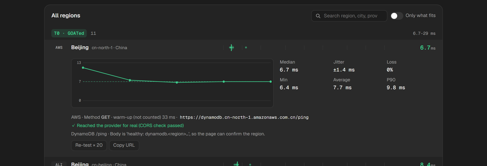
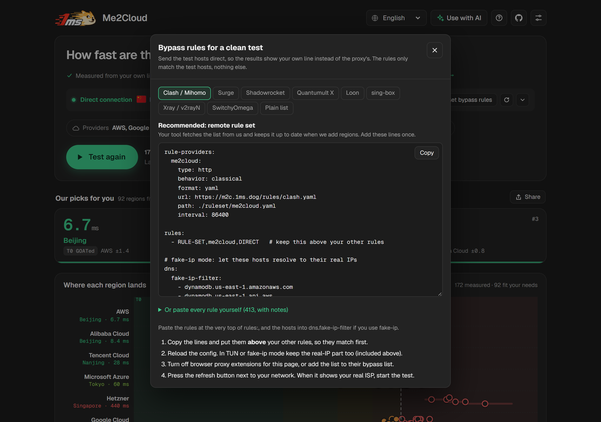
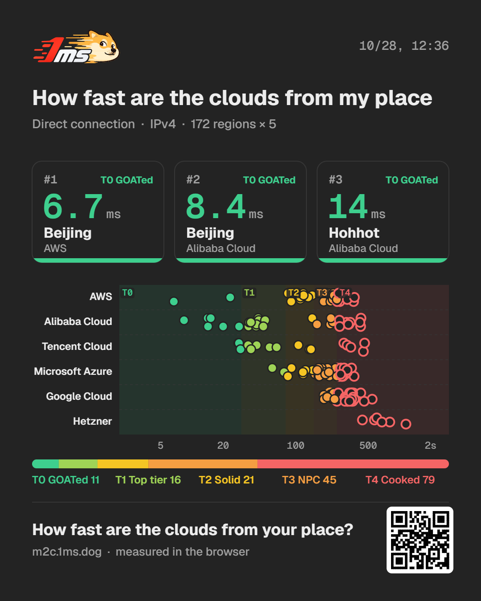
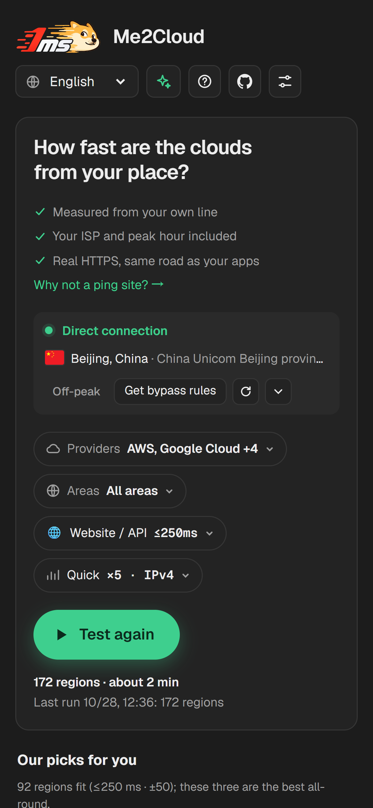

# Me2Cloud

**English** · [简体中文](README.zh-CN.md)

How fast is each cloud region from your own connection? Me2Cloud measures latency, jitter and packet loss from your browser to 361 regions of 17 cloud providers, over your real ISP, Wi‑Fi and peak hour. It's a static site with no backend.

**Live:** https://m2c.1ms.dog


## Why

Latency maps and provider looking glasses measure from datacenters with premium transit. That tells you how one datacenter reaches another, not how your ISP routes to a region or how crowded its links are at 9pm. Me2Cloud runs the test where you are, so the numbers are the ones you'll actually get.

## Features

- **Measured in your browser.** Every request goes straight from the visitor's browser to the provider. No server in between, no account, and the code has no analytics or tracking.
- **361 verified endpoints across 17 providers:** AWS, Azure, Google Cloud, Oracle Cloud, IBM Cloud, Alibaba Cloud, Tencent Cloud, Huawei Cloud, Volcengine, Baidu AI Cloud, Naver Cloud, Vultr, Akamai (Linode), DigitalOcean, Scaleway, OVHcloud and Hetzner.
- **Real HTTPS on a warm connection.** The first request opens the connection and isn't counted; every sample after it reuses the connection. Each provider uses the request type verified to keep the connection alive (GET, HEAD, or `` for Hetzner).
- **Median, average, P90, jitter and loss** per region, with a live chart while it runs and every sample on click. Five tiers by median: T0 GOATed ≤30 ms, T1 Top tier ≤80 ms, T2 Solid ≤150 ms, T3 NPC ≤250 ms, T4 Cooked.
- **Picks for your use case:** gaming, video calls, SSH or a website, each with its own latency, jitter and loss limits. Regions in your own country can be included, excluded or tested alone.
- **IPv4 or IPv6.** IPv6 mode switches to each provider's AAAA hosts and lists regions without one separately.
- **Proxy detection and direct rules.** It flags datacenter exits, timezone mismatches, WARP, and WebRTC or IPv4/IPv6 exits that differ from the HTTPS exit. It then generates direct rules for Clash/Mihomo, Surge, Shadowrocket, Quantumult X, Loon, sing-box, Xray and SwitchyOmega, as remote rule sets or inline. The rules list only the 413 exact hostnames the test uses.
- **Custom endpoints.** Add any HTTPS URL, such as your own VPS, and compare it with the providers.
- **Share without a server.** The share link carries compressed results in the URL hash, and the share image is drawn in the browser.
- **Use with AI.** Copy a summary of your results into any assistant, or point an agent at [`llms.txt`](https://m2c.1ms.dog/llms.txt) to build test links.
- **10 languages,** pre-rendered, plus a landing page per provider (`/aws/`, `/zh-cn/aws/` …).
- **Polite to providers.** One request at a time per host, at least 250 ms apart, at most 21 per host per run; a host is skipped after 3 failures in a row.

| Every sample of a region | Direct rules for your proxy tool |
|---|---|
|  |  |

| Share image | On a phone | 简体中文 |
|---|---|---|
|  |  |  |

## Self-hosting

You don't need to host anything to use Me2Cloud: https://m2c.1ms.dog works for everyone. Host your own copy if you want it on your domain, inside a network that can't reach the public site, or with your own changes.

The site is plain static files. The built pages are committed in `public/`, so there's no build step unless you change something.

### Cloudflare Workers (recommended, free)

There's no Worker script, so every request is a static asset request: free and unmetered. You need Node.js 20+ and a Cloudflare account.

```bash
git clone https://github.com/yt1988/me2cloud
cd me2cloud
npx wrangler login
npx wrangler deploy
```

`wrangler.toml` turns off the `*.workers.dev` address and preview URLs, so the site serves only on a domain you bind. Then:

1. In the Cloudflare dashboard, open **Workers & Pages → me2cloud → Settings → Domains & Routes** and add a custom domain, such as `ping.example.com`. The domain's zone has to be on the same Cloudflare account.
2. No domain yet? Set `workers_dev = true` in `wrangler.toml` and deploy again; the site comes up at `https://me2cloud.<your-subdomain>.workers.dev`.

On Windows PowerShell, if `npx` fails with "running scripts is disabled", use `npx.cmd` instead (for example `npx.cmd wrangler deploy`).

### Use your own domain in links and previews

The page works on any domain as it is. The remote rule sets, share links and share image follow the address the page is served from. Canonical tags, the sitemap and link previews are generated at build time and point to m2c.1ms.dog by default. To point them at your domain, rebuild with `SITE_URL`:

```bash
SITE_URL=https://ping.example.com node scripts/build.mjs
npm install && SITE_URL=https://ping.example.com node scripts/assets.mjs   # preview images print the domain too
npx wrangler deploy
```

`public/llms.txt` is a hand-written file. Edit the addresses in it if you use it.

### Other static hosts

Serve the `public/` folder from anything that serves files: Cloudflare Pages, Netlify, nginx, Caddy, an S3 bucket.

- Cloudflare Pages and Netlify read `public/_headers` (security headers including the CSP, and cache rules). Elsewhere, copy them into your server config if you want them; the site works without them.
- Folders need to serve their `index.html` (`/zh-cn/` → `/zh-cn/index.html`), which is the default almost everywhere.

### Forks and the workflows

- `check.yml` runs on every push and fails if `public/` is out of date with `src/`.
- `health.yml` probes every endpoint each Monday and opens an issue when some fail. GitHub doesn't run scheduled workflows on forks until you enable Actions in the fork; leave it off if you don't need it.

## Development

```bash
node scripts/dev.mjs          # http://localhost:8787, with the production headers
node scripts/build.mjs        # regenerate public/ after changing src/
npm test                      # fails if public/ is stale
```

```
src/page.html              page template: styles, logic, endpoint registry (ENDPOINTS block)
src/i18n/*.mjs             text per language; missing keys fall back to en.mjs
src/brand/                 favicon source
scripts/build.mjs          builds public/: language pages, provider pages, app.<hash>.js, endpoints.json, rule sets, sitemap, _headers
scripts/assets.mjs         favicon and per-language preview images (needs npm install)
scripts/i18n-tool.mjs      node scripts/i18n-tool.mjs missing → keys missing per language
scripts/dev.mjs            local preview with the _headers rules applied
scripts/endpoints/         candidate list, verification, IPv6 checks, registry builder, weekly health check
public/                    the deployable site
.github/workflows/         check.yml (build up to date), health.yml (weekly endpoint check)
```

The build script has no dependencies. Only `scripts/assets.mjs` needs `npm install` (resvg for the images).

### Updating endpoints

```bash
node scripts/endpoints/verify.mjs          # verify every candidate (DNS through Cloudflare DoH)
node scripts/endpoints/ipv6.mjs            # check AAAA records of each host and its IPv6 alternative
node scripts/endpoints/build-registry.mjs  # write the ENDPOINTS block in src/page.html
node scripts/build.mjs                     # regenerate public/
```

Per-provider request methods, tiers and notes live in `VENDORS` in `scripts/endpoints/build-registry.mjs`. They come from tests in a real browser.

## Limitations

- It measures one location, yours. Your users may see different numbers.
- It tests each provider's public API or storage endpoint, not a VM. Premium network tiers can differ.
- No bandwidth, UDP or traceroute.
- HTTPS adds a small, steady server cost per sample (about 0–5 ms on AWS, ~8 ms on Alibaba Cloud, ~20 ms on Huawei OBS), so very close regions read slightly higher than ping.

## License

MIT
