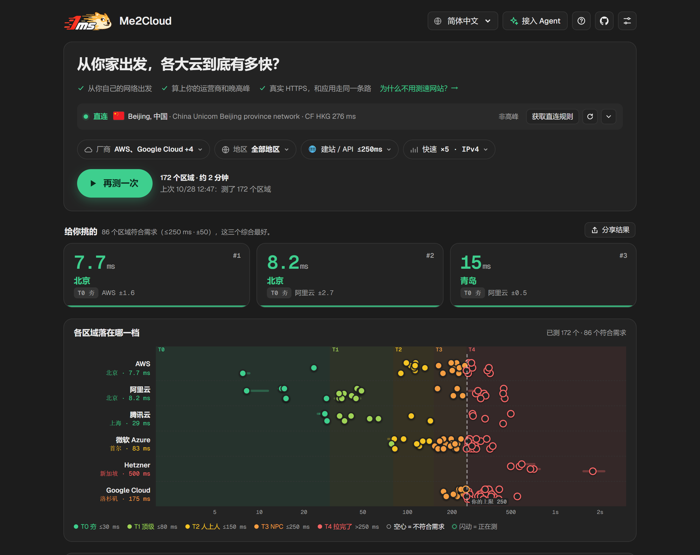
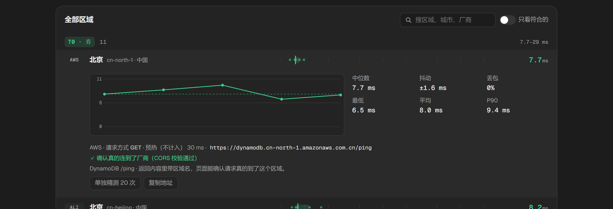
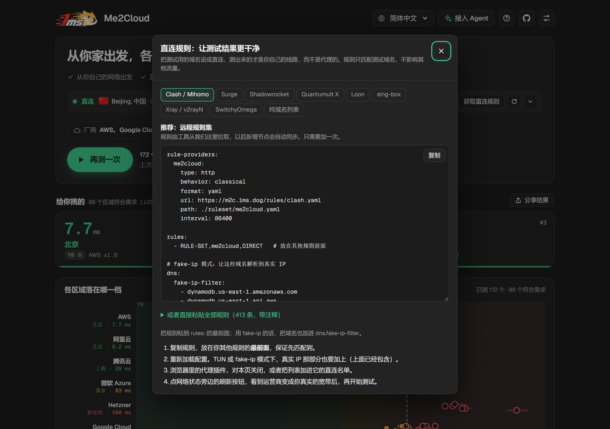
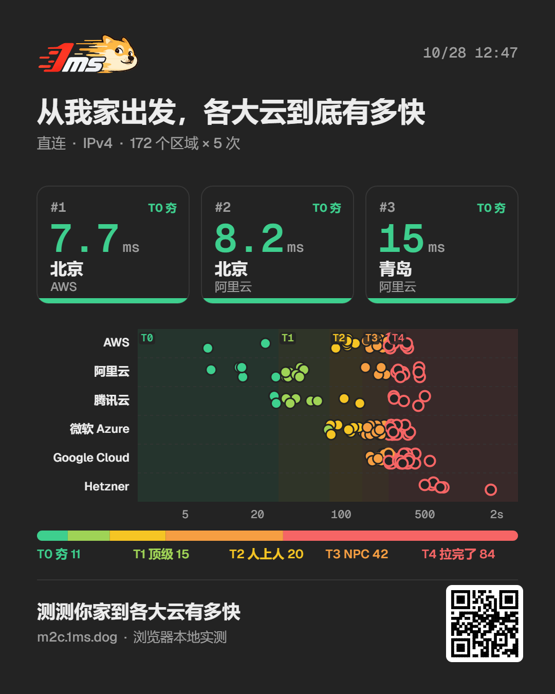
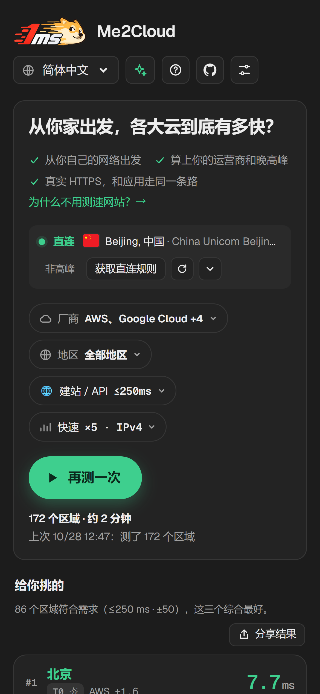
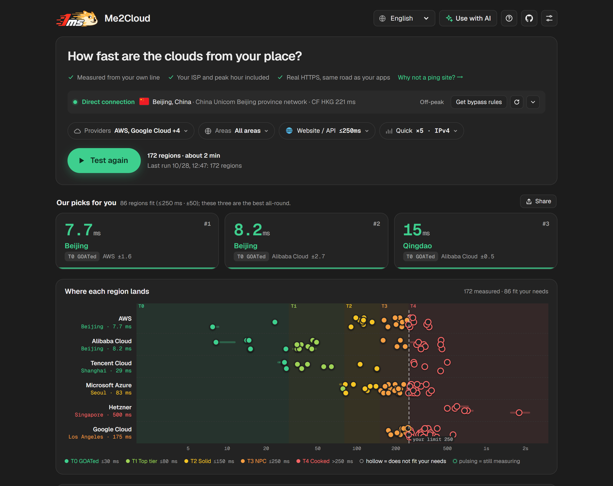

# Me2Cloud

[English](README.md) · **简体中文**

从你自己的网络出发，各家云的每个区域到底有多快？Me2Cloud 在你的浏览器里测量到 17 家云厂商、361 个区域的延迟、抖动和丢包，算上你真实的运营商、Wi‑Fi 和晚高峰。纯静态站点，没有后端。

**线上地址：** https://m2c.1ms.dog



## 为什么做这个

测速网站和厂商的 Looking Glass 都是从机房测的，机房用的是优质线路。它们能告诉你机房到机房有多快，却测不到你的运营商怎么绕路、晚上九点国际出口有多挤。Me2Cloud 在你所在的地方发起测试，测出来的就是你实际会拿到的数字。

## 功能

- **在你的浏览器里测**：每个请求都从访问者的浏览器直接发给厂商，中间没有服务器，不用登录，代码里也没有统计和追踪。
- **17 家厂商、361 个验证过的端点**：AWS、Azure、Google Cloud、Oracle Cloud、IBM Cloud、阿里云、腾讯云、华为云、火山引擎、百度智能云、Naver Cloud、Vultr、Akamai（Linode）、DigitalOcean、Scaleway、OVHcloud、Hetzner。
- **复用连接的真实 HTTPS 请求**：第一个请求只用来建连接，不计入；之后每个样本都复用这条连接。每家厂商用的是实测能保持连接的请求方式（GET、HEAD，Hetzner 用 ``）。
- **每个区域给出中位数、平均、P90、抖动和丢包**，测试时图表实时刷新，点开能看每一次采样。按中位数分五档：T0 夯 ≤30 ms、T1 顶级 ≤80 ms、T2 人上人 ≤150 ms、T3 NPC ≤250 ms、T4 拉完了。
- **按用途推荐**：游戏、视频会议、SSH、建站各有一套延迟、抖动、丢包要求。本国的区域可以选择包含、排除或只看。
- **IPv4 或 IPv6**：IPv6 模式改用各厂商带 AAAA 记录的主机，没有 IPv6 端点的区域单独列出。
- **代理检测和直连规则**：出口是机房网络、时区和出口国家对不上、开着 WARP、WebRTC 或 IPv4/IPv6 出口和 HTTPS 出口不一致时会提示。然后给出 Clash/Mihomo、Surge、Shadowrocket、Quantumult X、Loon、sing-box、Xray、SwitchyOmega 的直连规则，有远程规则集也有直接粘贴的版本。规则只包含测试用到的 413 个精确域名。
- **自定义端点**：加任意 HTTPS 地址，比如你自己的 VPS，和各家厂商放在一起比。
- **分享不经过服务器**：分享链接把压缩后的结果放在 URL 里，分享图在浏览器里画出来。
- **接入 Agent**：把测试结果摘要复制给任意 AI 助手，或者让 Agent 读 [`llms.txt`](https://m2c.1ms.dog/llms.txt) 来生成测试链接。
- **10 种语言**，全部预渲染，外加每家厂商一个落地页（`/aws/`、`/zh-cn/aws/`……）。
- **不给厂商添麻烦**：同一个主机同时只有一个请求，间隔至少 250 ms，单次最多 21 个请求，连续失败 3 次就跳过。

| 单个区域的每一次采样 | 代理工具的直连规则 |
|---|---|
|  |  |

| 分享图 | 手机上 | English |
|---|---|---|
|  |  |  |

## 自己部署

用 Me2Cloud 不需要自己部署，https://m2c.1ms.dog 谁都能用。想放在自己的域名上、在访问不了公共站点的网络里用，或者想自己改，再部署一份。

整个站点就是一堆静态文件。构建好的页面已经提交在 `public/` 里，不改代码就不需要构建。

### Cloudflare Workers（推荐，免费）

没有 Worker 脚本，所有请求都是静态资源请求，免费且不计量。需要 Node.js 20+ 和一个 Cloudflare 账号。

```bash
git clone https://github.com/yt1988/me2cloud
cd me2cloud
npx wrangler login
npx wrangler deploy
```

`wrangler.toml` 关掉了 `*.workers.dev` 地址和预览地址，站点只在你绑定的域名上提供。接下来：

1. 在 Cloudflare 控制台打开 **Workers 和 Pages → me2cloud → 设置 → 域和路由**，添加自定义域名，比如 `ping.example.com`。这个域名要托管在同一个 Cloudflare 账号下。
2. 暂时没有域名？把 `wrangler.toml` 里的 `workers_dev` 改成 `true` 再部署一次，站点会出现在 `https://me2cloud.<你的子域>.workers.dev`。

Windows PowerShell 下如果 `npx` 报「禁止运行脚本」，改用 `npx.cmd`，比如 `npx.cmd wrangler deploy`。

### 让链接和预览图用你的域名

页面放在任何域名下都能直接用。远程规则集、分享链接和分享图会跟着页面所在的地址走。canonical 标签、sitemap 和链接预览是构建时生成的，默认指向 m2c.1ms.dog。想改成你的域名，用 `SITE_URL` 重新构建：

```bash
SITE_URL=https://ping.example.com node scripts/build.mjs
npm install && SITE_URL=https://ping.example.com node scripts/assets.mjs   # 预览图上也会印上这个域名
npx wrangler deploy
```

`public/llms.txt` 是手写的文件，要用的话把里面的地址也改一下。

### 其他静态托管

把 `public/` 目录交给任何能托管静态文件的服务就行：Cloudflare Pages、Netlify、nginx、Caddy、S3 存储桶都可以。

- Cloudflare Pages 和 Netlify 会读取 `public/_headers`（安全响应头，包括 CSP，以及缓存规则）。其他服务需要的话自己搬到服务器配置里，不搬也能正常用。
- 访问目录时要返回目录里的 `index.html`（`/zh-cn/` → `/zh-cn/index.html`），绝大多数服务默认就是这样。

### Fork 之后的工作流

- `check.yml` 每次 push 都会跑，`public/` 和 `src/` 不一致时失败。
- `health.yml` 每周一探测所有端点，有失败就开 issue。GitHub 默认不在 fork 里运行定时工作流，需要在 fork 里手动启用 Actions；用不到可以不开。

## 开发

```bash
node scripts/dev.mjs          # http://localhost:8787，带生产环境的响应头
node scripts/build.mjs        # 改了 src/ 之后重新生成 public/
npm test                      # public/ 不是最新时失败
```

```
src/page.html              页面模板：样式、逻辑、端点注册表（ENDPOINTS 区块）
src/i18n/*.mjs             各语言文案，缺的键回退到 en.mjs
src/brand/                 favicon 源文件
scripts/build.mjs          生成 public/：各语言页面、厂商页面、app.<hash>.js、endpoints.json、规则集、sitemap、_headers
scripts/assets.mjs         favicon 和各语言的预览图（需要 npm install）
scripts/i18n-tool.mjs      node scripts/i18n-tool.mjs missing → 列出各语言缺的键
scripts/dev.mjs            本地预览，套用 _headers
scripts/endpoints/         候选清单、验证、IPv6 检查、注册表生成、每周健康检查
public/                    可以直接部署的站点
.github/workflows/         check.yml（构建是否最新）、health.yml（每周端点检查）
```

构建脚本零依赖，只有 `scripts/assets.mjs` 需要 `npm install`（用 resvg 生成图片）。

### 更新端点

```bash
node scripts/endpoints/verify.mjs          # 验证全部候选端点（DNS 走 Cloudflare DoH）
node scripts/endpoints/ipv6.mjs            # 检查各主机及 IPv6 备用主机的 AAAA 记录
node scripts/endpoints/build-registry.mjs  # 写回 src/page.html 的 ENDPOINTS 区块
node scripts/build.mjs                     # 重新生成 public/
```

各厂商的请求方式、档位和说明在 `scripts/endpoints/build-registry.mjs` 的 `VENDORS` 里，都来自真实浏览器里的实测。

## 局限

- 测的是一个地方，也就是你这里。你的用户可能会得到不同的结果。
- 测的是各厂商公开的 API 或存储端点，不是虚拟机。精品网络线路可能不一样。
- 不测带宽、UDP，也不做路由追踪。
- HTTPS 每个样本会多一点稳定的服务器处理时间（AWS 约 0–5 ms，阿里云约 8 ms，华为云 OBS 约 20 ms），所以离你很近的区域读数会比 ping 略高。

## 许可证

MIT
